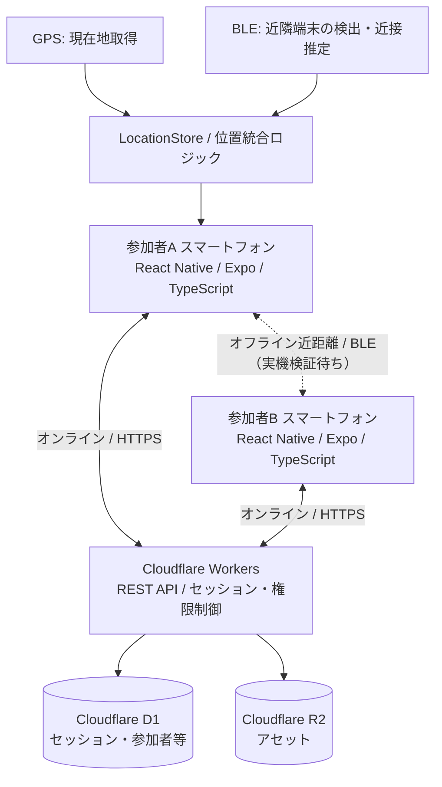
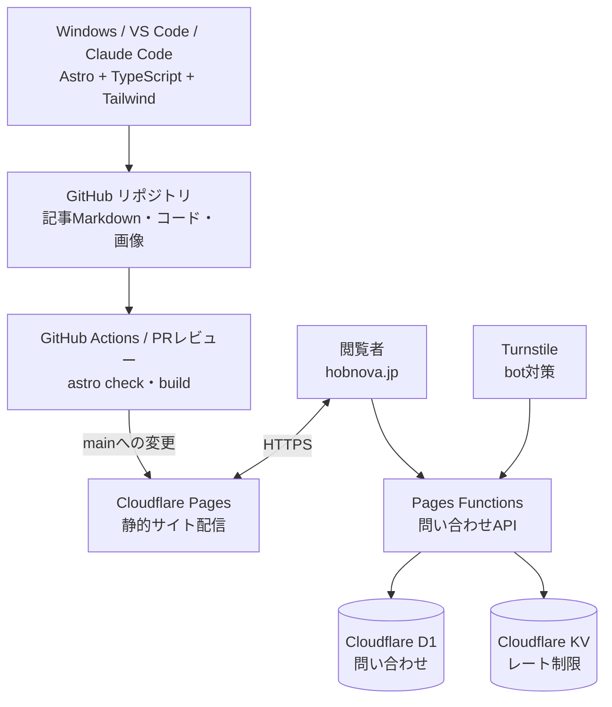
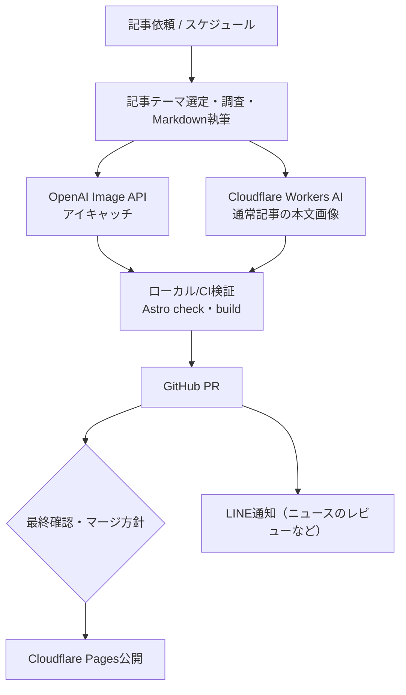
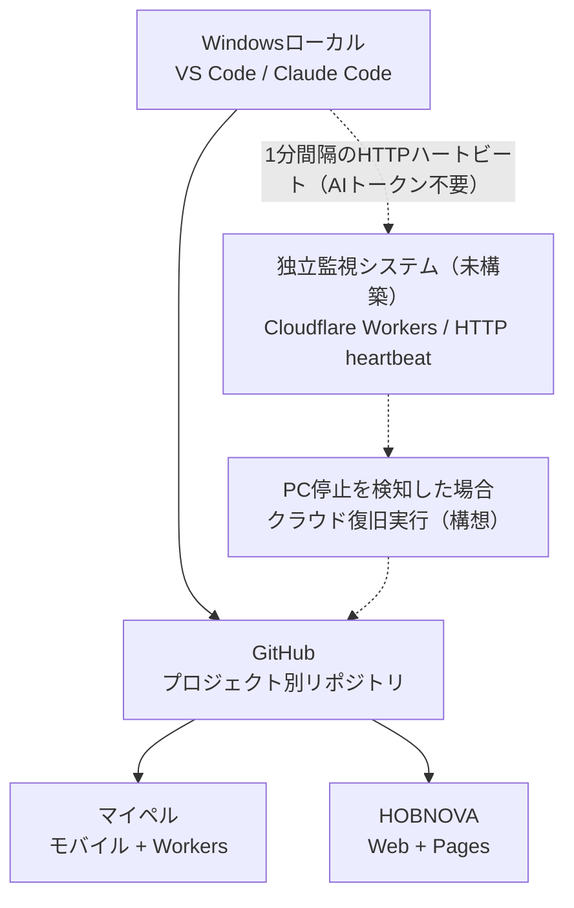

# 開発プロジェクト全体構成図

> 更新日：2026-10-18  
> このページは「マイペル」「HOBNOVA」と共通開発監視基盤の構成を一覧するための資料です。  
> **確度について：** HOBNOVA は GitHub の現行 `main` の主要ファイルを確認。マイペルは開発会話・実装報告に基づく設計図で、現在のリポジトリや実機状態とは未照合です。

## 目次
- [比較](#比較)
- [マイペル（MAIPER）](#マイペルmaiper)
- [HOBNOVA](#hobnova)
- [共通開発運用と復旧構想](#共通開発運用と復旧構想)
- [運用と更新方法](#運用と更新方法)

## 比較

| 項目 | マイペル（MAIPER） | HOBNOVA |
| --- | --- | --- |
| 目的 | 混雑・通信不安定下でも合流する位置共有アプリ | 記事・比較・データ可視化・ツール提供サイト |
| ユーザー向けUI | React Native + Expo | Astro 7 + Tailwind CSS 4 |
| 共通言語 | TypeScript | TypeScript |
| クラウド処理 | Cloudflare Workers + REST API | Cloudflare Pages Functions、記事生成CLI/Actions |
| 永続データ | Cloudflare D1 | D1（問い合わせ）、KV（レート制限） |
| ストレージ | Cloudflare R2 | リポジトリ内のMarkdown・静的画像等 |
| 特色 | GPS + BLE + サーバー統合 | AI記事生成 + OpenAI画像 + Cloudflare Workers AI |
| 検証上の注意 | BLE実機E2Eは未確認 | 画像反映・記事品質・公開処理は継続確認が必要 |

## マイペル（MAIPER）

### 全体構成

- 画面：会場地図、位置表示、グループ、待ち合わせ地点、セッション有効時間。
- `src/location/` 等に BLE 接続制御、イベント競合対策、GPS/BLE統合と診断UIの実装報告あり。
- セッション失効後の位置更新を拒否し、グループの操作権限を検証する方針。
- **未検証：** 実機でのBLE接続・オフライン位置推定のE2E、配布経路など。設計上の経路を本番動作保証とみなさない。

## HOBNOVA

### 公開サイトの構成

### 記事制作パイプライン

- **通常記事：** `scripts/run-daily-article-pipeline.ts` は画像生成・check/buildまでのCLI。PR作成は別運用。通常記事の定期公開処理は `scripts/daily-publish-check.mjs`。
- **朝夜ニュース：** `scripts/news-publish.mjs` は調査・重複除外・記事/カバー作成・検証・PR・LINE通知まで。2026-10-18時点のコード上、**人間の最終マージを待つ設計**。
- **静的コンテンツ：** `src/content/articles/` 等のMarkdownからAstroでページを生成。訪問のたびにAI生成する仕組みではない。
- **可視化：** Chart.js、ツール類のクライアント処理。
- 技術の根拠：リポジトリの `package.json`、`wrangler.toml`、`README.md` および上記スクリプト（2026-10-18確認）。

## 共通開発運用と復旧構想

監視・フェイルオーバーは両プロジェクトとは**独立リポジトリ**として作成する方針。図中の監視/クラウド復旧経路は現在の構想であり、構築済み・運用中の意味ではありません。

## 運用と更新方法

- このページをシステム構成図の**参照用入口**としてブックマークする。
- 変更時は図・使用技術・「実装済み／未検証／構想」の状態と更新日を一緒に修正する。
- マイペルの実リポジトリが特定できた時点でソース照合し、推定ベースの記述を更新する。
- 将来的にはプロジェクト横断ドキュメントを専用の独立リポジトリへ移すこともできる。現時点は既存アクセス可能なHOBNOVAリポジトリに保管している。
